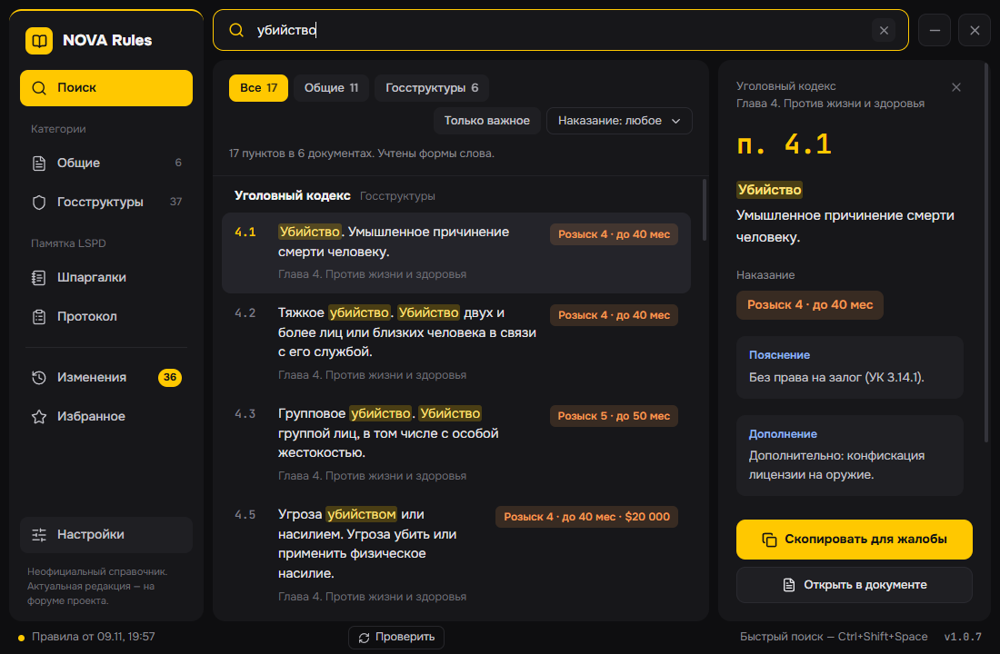
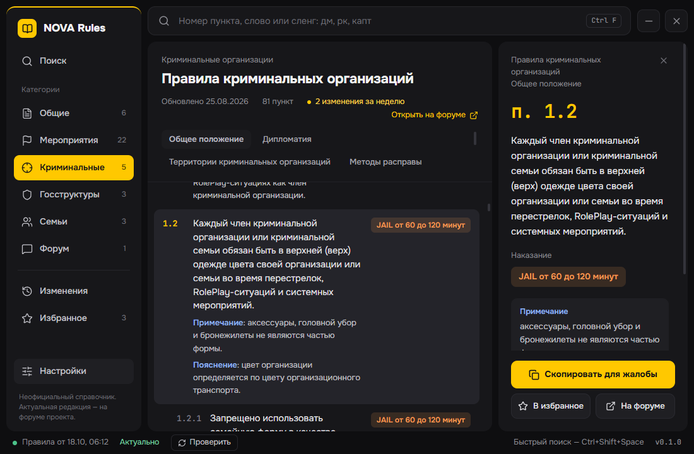
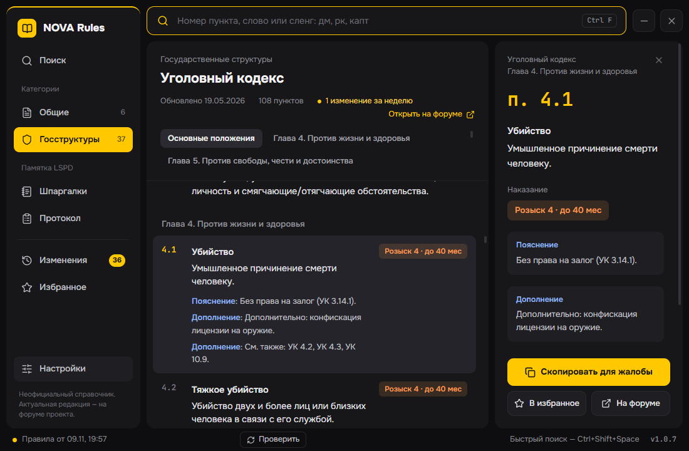
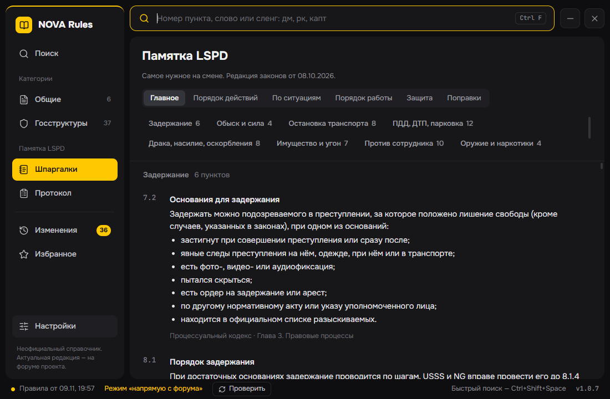
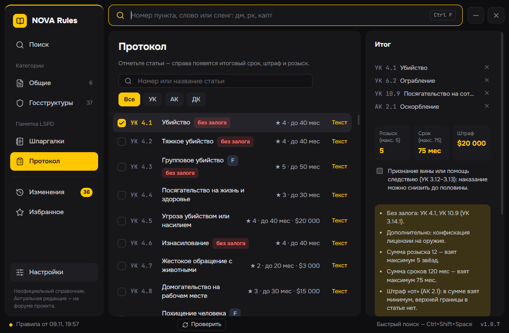
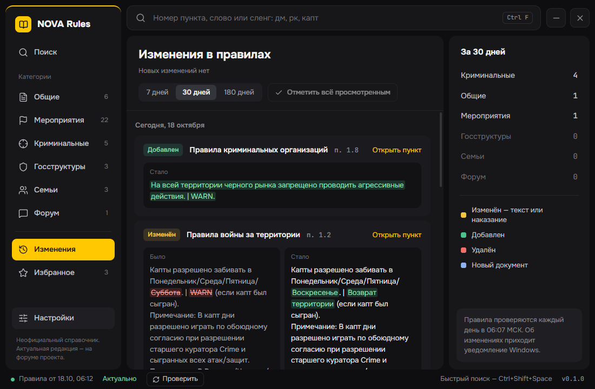

# NOVA Rules

Справочник правил NOVA RP (GTA 5 RP) для Windows. Все правила сервера и законы штата в одном окне: найти нужный пункт можно за секунды, в том числе прямо во время игры.

### [⬇ Скачать NOVA Rules для Windows](https://github.com/sdobnikovivan7-source/nova-rules/releases/latest/download/NOVA-Rules-Setup.exe)

## Чем поможет

- **Не нарушить правила.** Нужный пункт находится по любому слову, сленгу или номеру. Не нужно листать десятки тем на форуме.
- **Написать жалобу.** Пункт с номером и ссылкой на форум копируется одной кнопкой.
- **Быть в курсе правок.** Правила проверяются каждый день. О каждом изменении приходит уведомление, видно, что было и что стало.
- **Госструктурам — работать на смене.** Шпаргалки по задержанию, остановке транспорта и обыску, статьи УК, АК и ДК с розыском, сроками и штрафами, калькулятор протокола.

## Что умеет

- **Поиск по всем пунктам**: слова в любой форме, опечатки, сленг (ДМ, РК, ПГ, капт), номер пункта (`1.2`, `крайм 1.2`). Есть фильтры по категории и наказанию.
- **Правила по категориям**: общие, мероприятия, криминальные, госструктуры, семьи, форум. У каждого пункта есть ссылка на тему форума.
- **Направление игрока.** «Общие» показывают все разделы правил, «Госструктуры» — общие правила, правила госструктур и законы штата.
- **Законы штата для госструктур**: Уголовный, Административный, Процессуальный и Дорожный кодексы, Конституция, Устав LSPD и ещё почти 30 законов, кратко и по делу.
- **Шпаргалки**: главное на смене, порядок действий, статьи по ситуациям, порядок работы, что проверяют прокуратура и FIB, поправки к законам.
- **Калькулятор протокола**: отметьте статьи, и он посчитает срок, штраф и розыск с учётом лимитов. Подскажет, если статья федеральная или без права на залог, а готовый текст скопирует для протокола.
- **«Скопировать для жалобы»**: текст пункта с номером и ссылкой копируется в буфер обмена.
- **Лента изменений** («было / стало») и уведомления Windows о новых правках.
- **Быстрый поиск поверх игры** по `Ctrl+Shift+Space`, сочетание можно поменять. Работает, когда игра запущена «В окне» или «Без рамки».
- **Избранное**, тёмная и светлая тема, размер текста 90–140 %.
- **Работает без интернета**: показывается последняя сохранённая версия правил.
- Обновляется само.

## Скриншоты

| Правила сервера                              | Законы штата                             |
| -------------------------------------------- | ---------------------------------------- |
|  |  |
| **Шпаргалки**                                | **Калькулятор протокола**                |
|            |     |

**Изменения в правилах**

## Установка

1. [Скачайте установщик](https://github.com/sdobnikovivan7-source/nova-rules/releases/latest/download/NOVA-Rules-Setup.exe).
2. Запустите его. Установка проходит в один клик и не требует прав администратора.

**Windows может показать «Система Windows защитила ваш компьютер»** (SmartScreen). Так бывает с любой программой без платной цифровой подписи. Нажмите **«Подробнее» → «Выполнить в любом случае»**.

Удалить приложение можно через «Параметры → Приложения».

## Сообщить об ошибке

- Пункт отображается неправильно: правой кнопкой по пункту → «Пункт отображается неправильно».
- Другое: «Настройки → О программе → Сообщить об ошибке» или [новая задача](https://github.com/sdobnikovivan7-source/nova-rules/issues/new/choose).

## Дисклеймер

Неофициальный справочник, не связан с администрацией NOVA RP. Актуальная редакция правил — на форуме проекта: https://forum.grand-rp.su/
