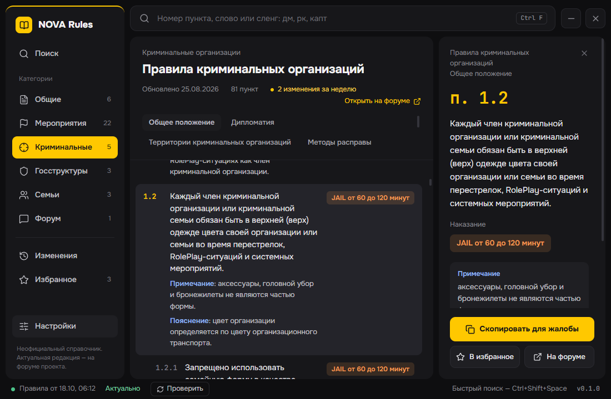
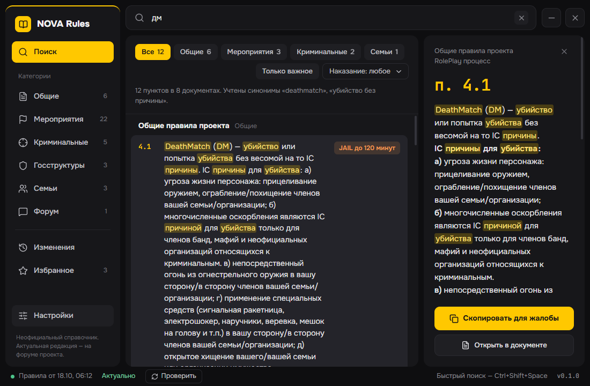
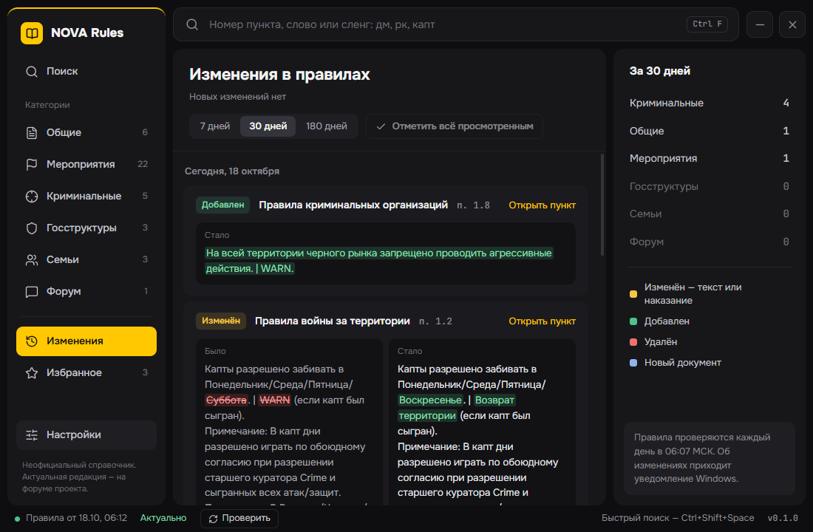

# NOVA Rules

Неофициальный справочник правил NOVA RP (GTA 5 RP) для Windows.

**[Скачать последнюю версию](https://github.com/sdobnikovivan7-source/nova-rules/releases/latest)** — файл `NOVA-Rules-Setup-x.y.z.exe`.



## Что умеет

- **Поиск по всем пунктам правил**: по словам в любой форме, с опечатками и сленгом (ДМ, РК, ПГ, капт), по номеру пункта — `1.2`, `крайм 1.2`. Фильтры по категории и наказанию.
- **Правила по категориям**: общие, мероприятия, криминальные, госструктуры, семьи, форум. У каждого пункта — ссылка на тему форума.
- **«Скопировать для жалобы»**: текст пункта с номером и ссылкой — в буфер обмена.
- **Изменения в правилах**: правила проверяются каждый день, лента показывает, что было и что стало. О новых правках приходит уведомление Windows.
- **Быстрый поиск поверх игры** по `Ctrl+Shift+Space` (сочетание меняется в настройках). Работает, когда игра запущена в режиме «В окне» или «Без рамки»; поверх полноэкранного режима Windows окна не показывает.
- **Избранное**, тёмная и светлая тема, размер текста 90–140 %.
- **Работает офлайн**: правила хранятся на компьютере, при запуске без интернета показывается последняя сохранённая версия.
- Приложение обновляется само.

| Поиск                                 | Изменения                                  |
| ------------------------------------- | ------------------------------------------ |
|  |  |

## Установка

1. Скачайте `NOVA-Rules-Setup-x.y.z.exe` со [страницы релизов](https://github.com/sdobnikovivan7-source/nova-rules/releases/latest).
2. Запустите. Установка — в один клик, без прав администратора, в профиль пользователя.

**Windows может показать «Система Windows защитила ваш компьютер»** (SmartScreen). Так бывает с любой программой без платной цифровой подписи от малоизвестного автора. Нажмите **«Подробнее» → «Выполнить в любом случае»**. Исходный код открыт, а в описании каждого релиза есть ссылка на проверку установщика на VirusTotal.

Удаление — через «Параметры → Приложения». Избранное и настройки остаются в `%APPDATA%\NovaRules`; удалите эту папку, если они не нужны.

## Приватность

Без телеметрии и аналитики, без учётных записей. Приложение обращается только к:

- серверу с правилами — GitHub (`cdn.jsdelivr.net`, `github.io`);
- GitHub Releases — проверка обновлений приложения;
- форуму проекта — картинки из правил и, если включено в настройках, загрузка правил напрямую с форума.

**Число игроков на плашке.** Раз в день приложение запрашивает с того же сервера маленький файл `stats.json` — обычный запрос, без идентификаторов и данных о вас. jsDelivr публично показывает, сколько раз запрашивали файл; раз в сутки GitHub Actions считает по этой статистике среднее за неделю и записывает его в тот же `stats.json` — это число и видно в приложении. Пока игроков меньше 10, плашка не показывается.

## Сообщить об ошибке

- Пункт отображается неправильно — правой кнопкой по пункту → «Пункт отображается неправильно».
- Другое — «Настройки → О программе → Сообщить об ошибке» или [новая задача](https://github.com/sdobnikovivan7-source/nova-rules/issues/new/choose).

Версии приложения и данных подставятся сами.

## Дисклеймер

Неофициальный справочник. Не связан с администрацией NOVA RP. Актуальная редакция правил — на форуме проекта: https://forum.grand-rp.su/

## Разработка

```
pnpm install
pnpm scrape --out out/data   # сборщик правил (--offline — из test/fixtures, без сети)
pnpm seed                    # out/data → resources/seed: данные для первого запуска
pnpm dev                     # приложение
pnpm build                   # сборка в out/
pnpm dist                    # установщик в dist/ (без публикации)
pnpm stats --out <stats.json> # пересчёт числа игроков (stats.yml раз в сутки)
pnpm test
```

Ветку `data` пишут два workflow: `scrape.yml` (правила; `stats.json` переносит из прошлой версии) и `stats.yml` (только `data/stats.json`). При ручной публикации правил `data/stats.json` тоже нужно сохранить.

Данные приложения — `%APPDATA%/NovaRules` (`nova.db`, `settings.json`, `logs/`). Чтобы заново наполнить базу из seed, удалите `nova.db*`. `NOVA_USER_DATA=<папка>` запускает приложение на отдельной папке данных (`pnpm demo-db <папка>` — демо-база с изменениями и избранным).

Выпуск версии: поднять `version` в `package.json`, `git tag vX.Y.Z && git push origin vX.Y.Z` — `release.yml` соберёт установщик и создаст черновик релиза.

## Лицензия

Код — MIT. Тексты правил принадлежат проекту NOVA RP.
